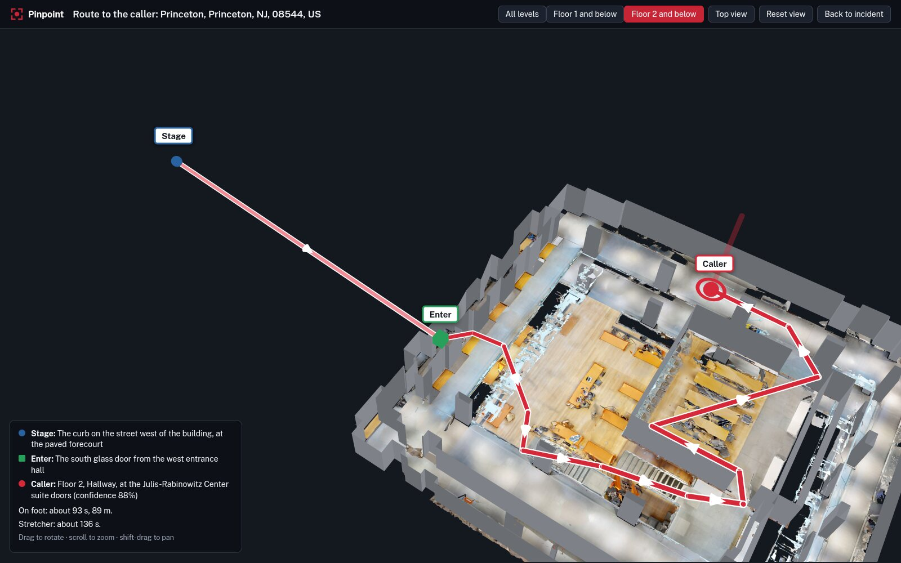
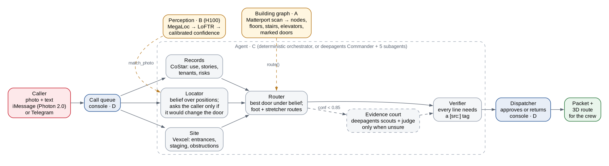
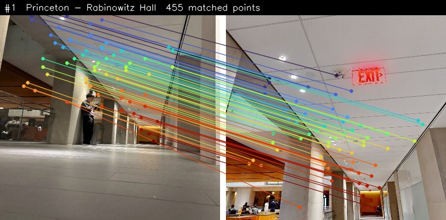

# Pinpoint



A 911 call from a large commercial building gives dispatch a street address, not the
floor, the room, or the door nearest the patient. With Pinpoint the caller texts one
photo. Pinpoint matches it to a position in the building's Matterport scan, picks the
door, routes a crew on foot and a crew with a stretcher, and gives the dispatcher a
one-page packet to approve: where to stage, which door, the route, what is on the way,
and who else is in the building. Every line in the packet traces to a CoStar record, a
scan position, or a Vexcel aerial image.

HackPrinceton F26. The full write-up, with figures and results, is [`devpost.md`](devpost.md).

## What is in the repo

| Folder | Part | What it does |
|---|---|---|
| `env/`, `buildings/` | A: graphs and routing | Building graphs from the Matterport scans, CoStar records, door-to-caller routing for a crew on foot and a stretcher |
| `perception/` | B: perception | Places a photo at a scanned position (MegaLoc embeddings, LoFTR re-rank, calibrated confidence); reads what is in view and the aerial image |
| `agent/` | C: the agent | Plans the incident, asks the caller questions only when the answer could change the door, checks every packet line, waits for approval; also runs as a LangChain deepagent |
| `live/photon.py`, `live/telegram.py` | D: text messaging | The caller's line: iMessage through Photon 2.0, or Telegram |
| `app/` | Frontend | The dispatcher console: call queue, route in the 3D scan, aerial approach, packet review and approval |
| `live/`, `pinpoint-gpu.sh` | Integration | Runs incidents through all of it on real data, on a laptop or on the team's GPU box |



| Sponsor technology | Where it is used |
|---|---|
| CoStar, Matterport, Vexcel (CoStar track) | All three layers, joined per address: records, scans and aerial imagery |
| LangChain deepagents | The agent's deepagents path and the evidence court (`agent/pinpoint/deep_agent.py`, `live/court.py`) |
| Photon 2.0 | The caller's iMessage line (`live/photon.py`, [`live/PHOTON.md`](live/PHOTON.md)) |
| Peri, Forward Deployed | Built from interviews with a firefighter, Will Turrell, and an EMT, Sophia Guo |

## Results

Held-out test (`live.evaluate --held-out`): each photo's own scanned position is removed
from the index, so the matcher knows the place only from neighbours 1 to 3 m away.

| Building | Within 5 m | Right floor | Right door |
|---|---|---|---|
| 7900 Fannin St, Houston | 11 / 12 | 12 / 12 | 10 / 12 |
| 12814 Willow Centre Dr, Houston | 9 / 12 | 11 / 12 | 10 / 12 |
| Rabinowitz Hall, Princeton | 8 / 10 | 10 / 10 | 10 / 10 |

These test photos are rendered from the scans. Real phone photos texted over iMessage
from inside Rabinowitz Hall were also placed where they were taken. A photo match takes
about 1 to 3 s on an H100 and 20 to 130 s on a laptop CPU. `live/README.md` has the
misses, the buildings, and what is and is not real.



## Run an incident end to end

Needs Node.js 20+, [`uv`](https://docs.astral.sh/uv/), and `api.txt` at the repo root.
One Python environment runs everything:

```sh
uv venv --python 3.12 .venv
uv pip install --python .venv/bin/python -r env/requirements.txt
.venv/bin/python -m live.setup        # once: console catalog, scan graphs, Matterport viewer
.venv/bin/python -m live.serve        # terminal 1: the console at http://localhost:4175/live.html
```

That is enough to run an incident where the caller's position is already known. In a
second terminal:

```sh
.venv/bin/python -m live.run --building 6550930 --position 3ymmrb --console --auto-approve
```

The console then shows the route drawn in the 3D scan, the route on the floor plan, and
the packet. Drop `--auto-approve` to make the agent wait for **Confirm & send** or
**Return** in the console.

To locate the caller from a photo, add part B's packages and build a photo index for
the building (a few minutes per building on a laptop CPU):

```sh
uv pip install --python .venv/bin/python --index-url https://download.pytorch.org/whl/cpu torch torchvision
uv pip install --python .venv/bin/python -r perception/requirements.txt huggingface_hub safetensors
.venv/bin/python -m live.index 6550930
```

Then run one incident from a photo:

```sh
.venv/bin/python -m live.run --building 6550930 --photo demo/6550930_gbqgw9.jpg --console
```

or leave the agent watching the console and start incidents there (pick a building,
**Start incident**, attach a caller photo):

```sh
.venv/bin/python -m live.run --watch
```

If photo matching is not installed or the building has no index, the run says so in
the terminal and the packet is marked DEGRADED with the reason; it does not pretend to
have located the caller.

**Callers over text.** With `PHOTON_PROJECT_ID` and `PHOTON_API_KEY` in the root `.env`,
`.venv/bin/python -m live.photon` connects the iMessage line: a texted photo opens an
incident in the console, and the agent's questions go back to the caller. Setup and
enrollment are in [`live/PHOTON.md`](live/PHOTON.md); `live.telegram` does the same over
Telegram.

**With a model in charge.** By default the agent's deterministic orchestrator runs the
steps. To put a model in charge of the tool calls instead (the deepagents path, Claude
Haiku, about two minutes and 0.20 USD per incident), install `agent/requirements.txt`
and add `--llm`:

```sh
uv pip install --python .venv/bin/python -r agent/requirements.txt
ANTHROPIC_API_KEY=... .venv/bin/python -m live.run --building 6550930 --photo demo/6550930_3ymmrb.jpg --console --llm
```

The packet is still written from the tools' results and checked line by line; the
model chooses the position and when to send. See "With a model in charge" in
`live/README.md`.

**On the GPU box.** The team's H100 runs the console, the matcher and the agent watcher.
`./pinpoint-gpu.sh open` tunnels its console to a laptop and opens it;
`./pinpoint-gpu.sh status` and `./pinpoint-gpu.sh logs` check on it.

If port 4175 is taken: `.venv/bin/python -m live.serve --port 4180`, and pass
`--console http://localhost:4180` to `live.run`. Open the console as `localhost`, not
`127.0.0.1`: the Matterport viewer key is tied to that name.

## Tests

```sh
.venv/bin/python -m unittest discover -s env/tests -t .     # A: graphs, routing, console export
.venv/bin/python -m unittest live.tests.test_live           # all parts together, with the console
for t in agent/tests/test_*.py; do .venv/bin/python $t; done   # C
(cd app && npm test)                                        # frontend
```

## Team

- Richard Shan: graphs, routing, integration
- Sophia Hou: perception, ML, integration
- Connor White: the deepagent (the PDF stuff)
- Sean Donahue: work on the text messaging and latency
