# Pinpoint

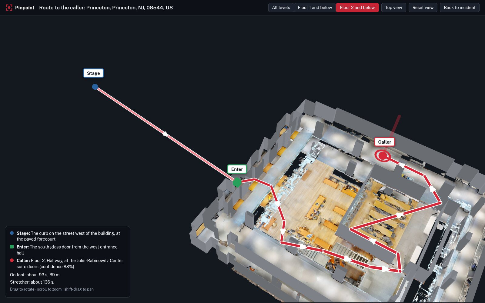

## Abstract

A 911 call from a large commercial building gives dispatch a street address. It does not give the floor, the room, or the door nearest the patient. With Pinpoint, the caller texts one photo. Pinpoint matches it to a position in the building's Matterport scan and picks the door to use. It then routes a crew on foot and a crew with a stretcher, and gives the dispatcher a one-page packet to approve. The packet covers where to stage, which door to use, the route, what is on the way, and who else is in the building. Every line in it traces to a CoStar record, a scan position, or a Vexcel aerial image. In a held-out test across three buildings, Pinpoint placed the caller **within 5 m in 28 of 34 runs, on the right floor in 33, and sent the crew through the right door in 30**. A photo is matched in **about 1–3 s on an H100**. Those test photos were rendered from the scans. Real phone photos, texted from inside Rabinowitz Hall at Princeton, were also placed where they were taken.

---

## 1. Problem Statement

The street address points to the front door, but the patient may be 40 m from the loading-dock door, two floors up a stairwell that a stretcher cannot use. No single dataset knows that.

We talked to Will Turrell, a firefighter, and Sophia Guo, an EMT. Will told us:

> "The main problem is physically getting to the room with all your tools and personnel, and... having a zone or map of the building with computer aided dispatch would be really useful."

So Pinpoint is built for the dispatcher, and the output is the map the first-arriving crew wants: where to stage, which door, and the route inside, laid out the way a computer-aided dispatch (CAD) screen is.

> **Peri, Forward Deployed Challenge.** Consulted: Will Turrell, firefighter, and Sophia Guo, EMT.

---

## 2. Dispatch Interface

**A call comes in.** The caller texts a photo over iMessage. It lands at the top of a CAD-style call queue with a priority set from the text. The caller gets an automatic reply at once.

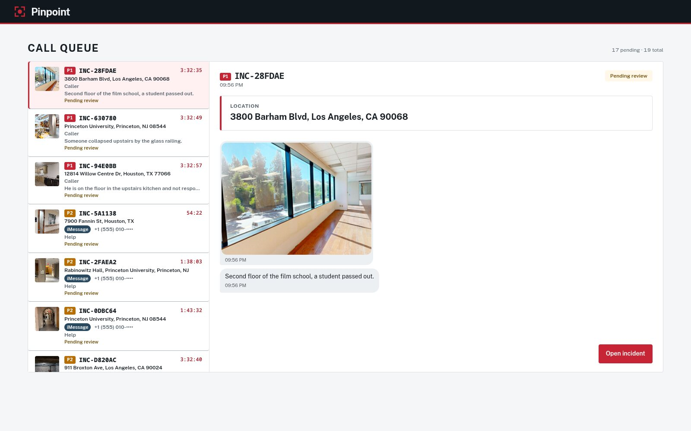

**The photo is placed in the scan.** The caller's photo (left) is matched against views cut from the building's scan (right). Each line joins two matched points.

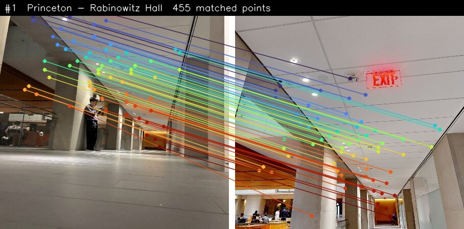

**The route.** The agent picks the door and routes to the caller. The incident opens on the building's 3D model with the route drawn through it, floor by floor (the image at the top of this page). The **Interior** toggle draws the route on the floor of the Matterport scan, and **Follow route** walks it facing the way the crew walks.

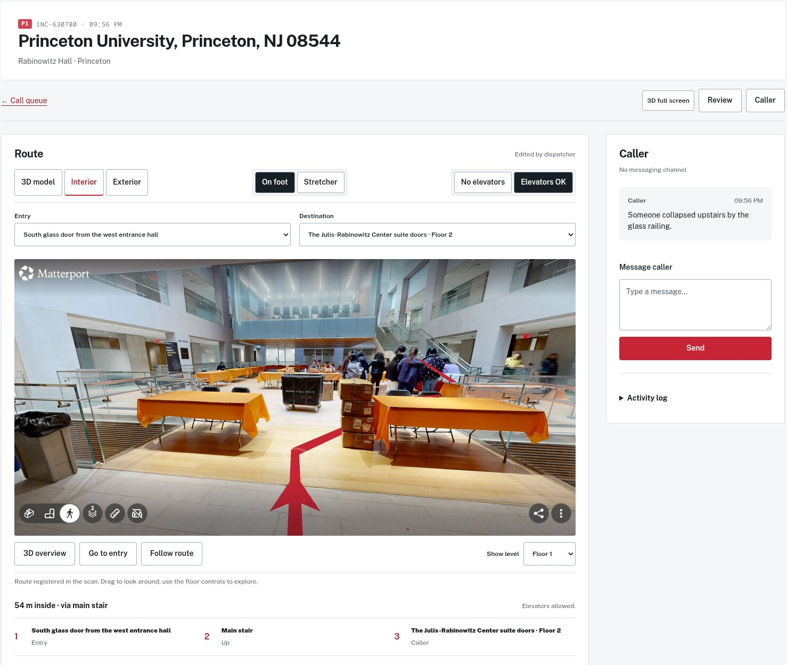

The **Exterior** toggle shows the staging spot and the door on the Vexcel aerial image.

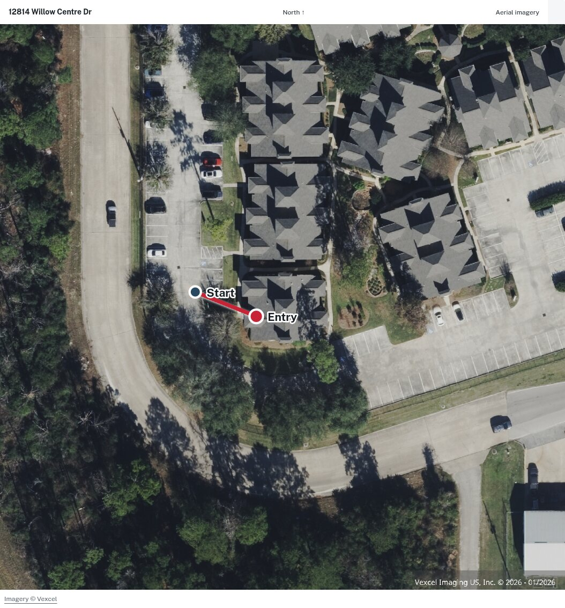

**The packet.** Every incident also gets a one-picture floor plan (staging, door, path, caller, with the caller's photo) and a packet where each line carries its source. In this incident at 7900 Fannin St, the best door is not the street-address door, and the stretcher has to use the swing door beside the revolving door.

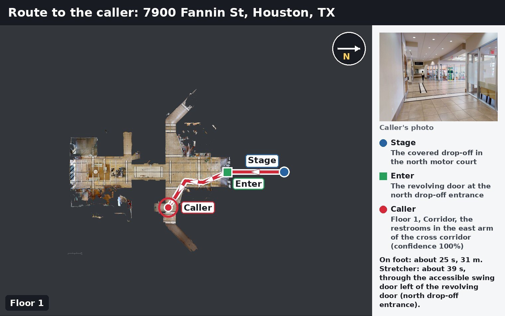

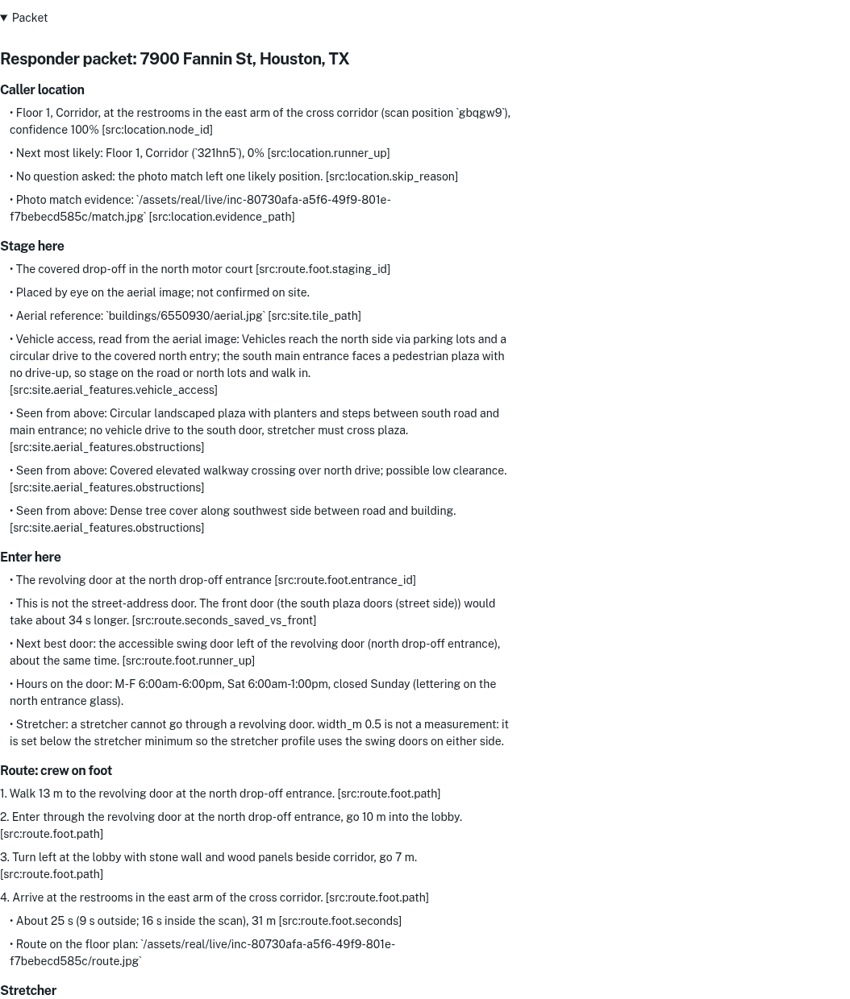

**Approval.** Nothing goes out until the dispatcher presses **Confirm & send** or **Return**. A "Verify" list says what nobody has checked: the staging spot was placed by eye, travel times are assumed, and the tenant list is CoStar's record rather than current occupancy.

---

## 3. Data

| Layer | Question it answers | What we derive from it |
|---|---|---|
| **CoStar** property records | What is this building, and who is in that suite? | Use, stories, year built, tenants, occupancy risks (clinic, daycare) |
| **Matterport** 3D scans | Where is the caller, and how do you get there? | Positions, floors, doors and widths, stairs, elevators, the route, what is in view |
| **Vexcel** aerial imagery | How do you approach from outside? | Entrances, staging spots, vehicle access, obstructions |

The same address, 7900 Fannin St in Houston, in each layer:

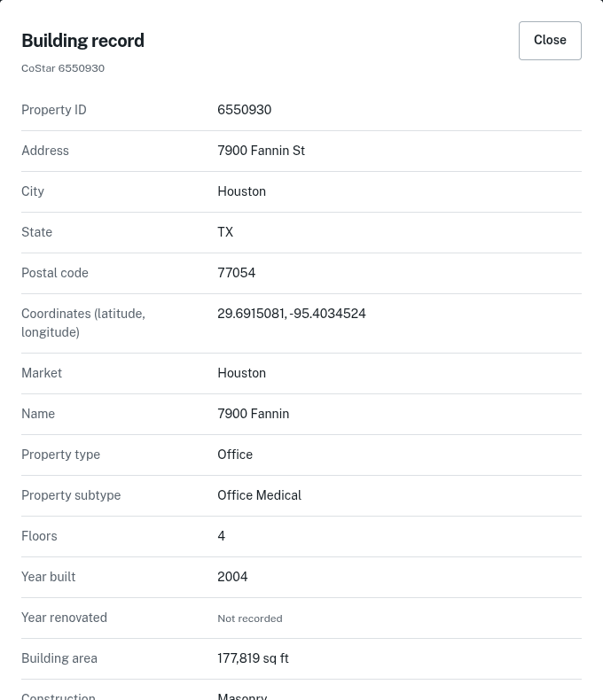

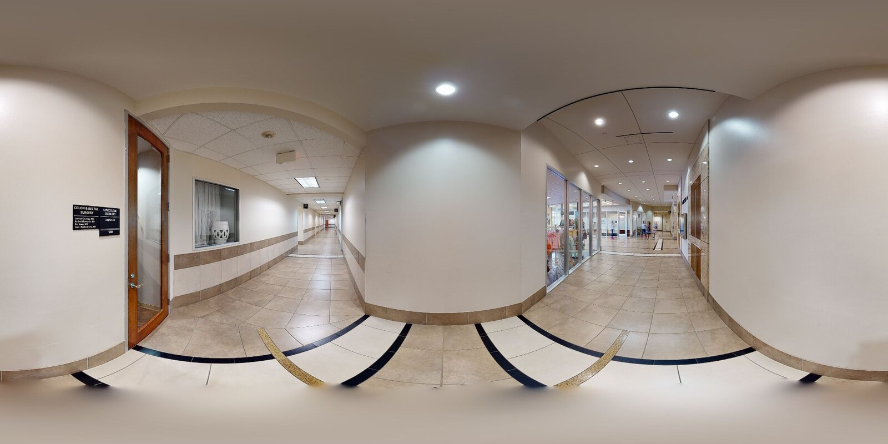

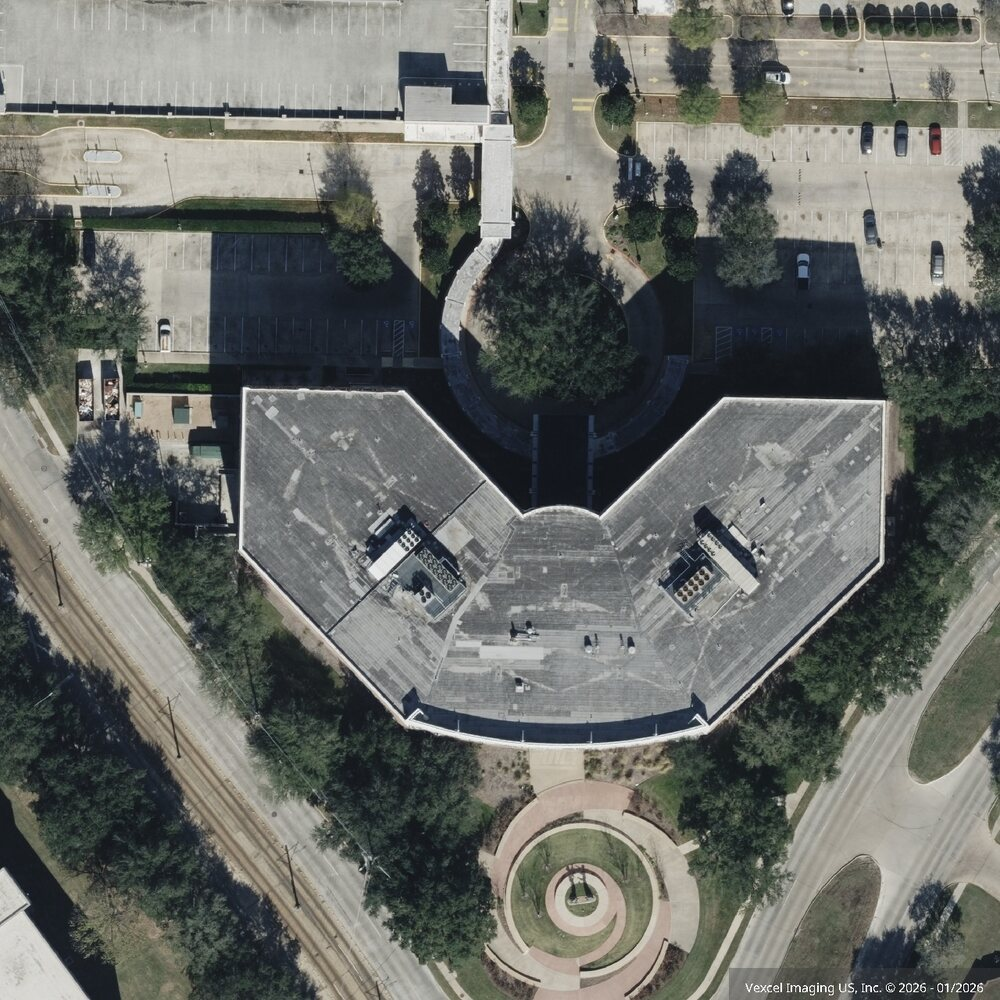

The answers come from combining layers. Two examples:

- **Best door:** the aerial image finds the doors, and the scan gives the time from each one to the caller.
- **Stretcher route:** the scan shows a stair. If CoStar says four stories, the stretcher needs the elevator, and that may mean a different door.

| Sponsor Technology | What we built for it | Section |
|---|---|---|
| **CoStar**: Inside and Out | All three layers, joined per address. An agent that plans, asks, checks itself, and stops for approval | 3, 4, 5, 7 |
| **LangChain**: Best use of deepagents | A Commander with five subagents, approval interrupts, memory from corrections, and an evidence court of deepagents scouts and a judge | 7 |
| **Photon**: Messaging agent on Photon 2.0 | The caller's iMessage line: photo in, questions and replies out | 6 |
| **Peri**: Forward Deployed Challenge | Built from a firefighter's and an EMT's account of the job | 1 |

There are eight buildings: seven from the CoStar kit (Houston and Los Angeles) and Rabinowitz Hall at Princeton. Rabinowitz has no CoStar record, but it is the one building where we could stand inside and take real photos. Between them the scans cover 1 to 5 levels each, and their graphs hold 845 nodes and 1,191 edges.

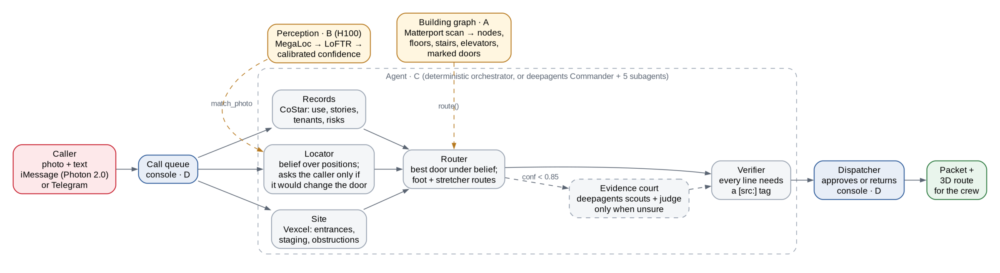

---

## 4. Building graphs and routing

**From scan to graph.** Each Matterport scanned position becomes a node. Matterport's "neighbors" are line-of-sight links, not walkable steps: they pass through glass, across atria and between floors. So [`env/build_graph.py`](https://github.com/richard-shan/phack-pinpoint/blob/main/env/build_graph.py) tests every link against the scan itself:

- **Walls.** A level link must not cross a wall. A link through a doorway becomes a `door` edge that carries the doorway's width.
- **Floor.** A link must stay over scanned floor. The floor image is transparent over an atrium or a stair well, and a link that crosses more than 1.2 m of that is dropped.
- **Stairs.** A link that climbs is kept as `stairs` only if its rise and run look like a stair.
- **Thinning.** The survivors are thinned to a spanner, so long shortcuts across a room go.
- **Entrances.** Doorways in walls that face only outside become entrance candidates.

**Marked by hand.** A scan cannot see some things: elevators, which doors are locked, or where an engine can stop. We marked these in `overrides.json` ([`env/MARKING.md`](https://github.com/richard-shan/phack-pinpoint/blob/main/env/MARKING.md)), with a scan crop as evidence for each one. The scans' georeference was 20–30 m off at several buildings, so doors and staging spots were placed by eye on the Vexcel aerial.

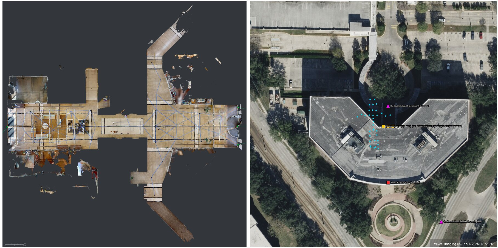

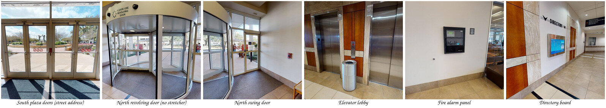

**Routing.** Edge costs are seconds, not meters, and there are two profiles. On foot: 1.4 m/s, 3 s per door, 25 s per floor of stairs. With a stretcher: 1.0 m/s and 8 s per door. A stretcher cannot use stairs, a door narrower than 0.75 m, or a revolving door. Elevators cost a 30 s wait plus 5 s per floor. These numbers are assumptions ([`env/config.py`](https://github.com/richard-shan/phack-pinpoint/blob/main/env/config.py)), and the packet says so.

- **`best_entry`** ranks every door by the time from its staging spot to the caller.
- **`best_entry_under_belief`** does the same over the agent's spread of likely positions, and reports how many seconds knowing the exact room would save. If that is over 15 s, the agent asks the caller.
- **`replan`** routes around a blocked segment.

Run over every position in every building ([`buildings/routing_metrics.json`](https://github.com/richard-shan/phack-pinpoint/blob/main/buildings/routing_metrics.json)):

| Building | Positions | Best door is not the street door | Most time saved | Stretcher cannot reach |
|---|---|---|---|---|
| 7900 Fannin St | 35 | 34 | 46 s | 0 |
| 12814 Willow Centre Dr | 114 | 40 | 22 s | 38 (upper floor, stairs only) |
| 911 Broxton Ave (5 levels) | 190 | 0 | 0 s | 20 |

`best_entry` takes a median of 0.07–0.36 ms per call.

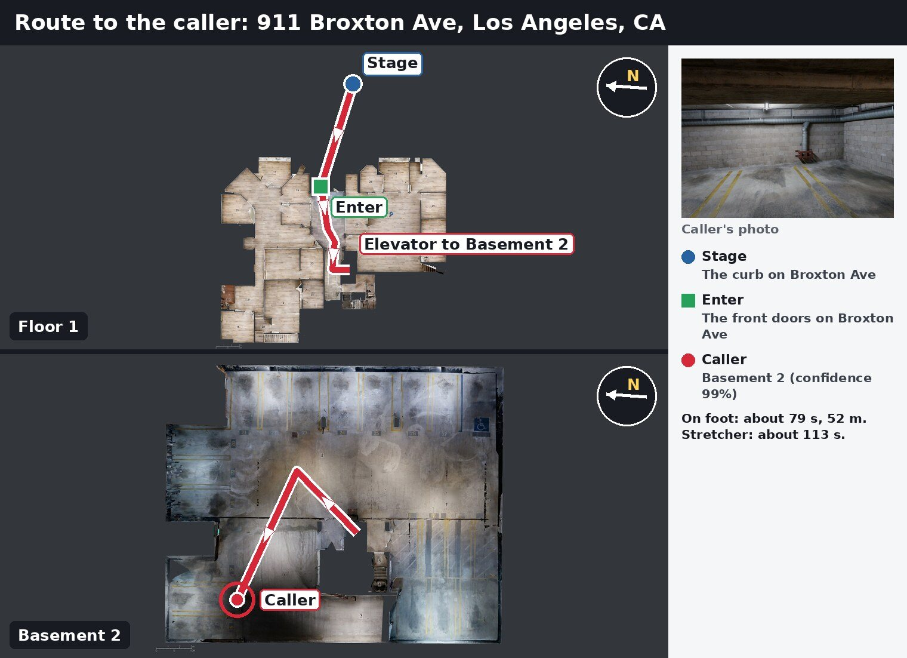

---

## 5. Locating the caller from a photo

**Index.** Each scanned position's panorama arrives as six 2048² cube faces. We cut 52 pinhole views of 448² from it:

- 36 views at a 60° field of view: 12 headings × 3 tilts;
- 16 views at 75°: 8 headings × 2 tilts.

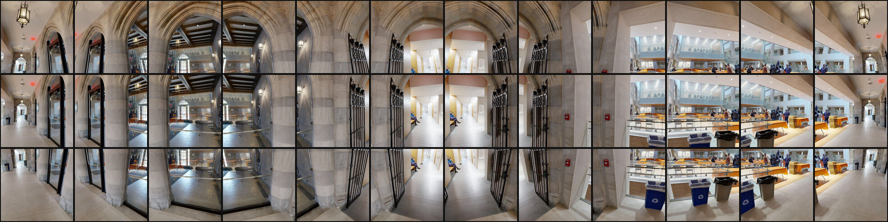

**Embeddings.** Each view is embedded with **MegaLoc**: a DINOv2-base ViT-B/14 backbone with an optimal-transport (SALAD-style) aggregation head trained for place recognition. It takes 322 px input and gives an 8,448-d vector, stored as float16. MegaLoc replaced our first descriptor, frozen DINOv2 (class token plus mean patch token, 1,536-d).

**Match.** A caller photo is matched in three steps ([`perception/match.py`](https://github.com/richard-shan/phack-pinpoint/blob/main/perception/match.py)):

1. **Shortlist.** The photo is embedded once. Each position is scored by its three most similar views, and the top 12 positions' best two views (24 pairs) go to the next step.
2. **Re-rank.** **LoFTR** (kornia, indoor weights) matches points between the photo and each view. A MAGSAC fundamental-matrix fit keeps only the geometrically consistent matches, and the ranking adds that inlier count to the embedding similarity.
3. **Confidence.** A logistic-regression calibrator ([`perception/calibrate.py`](https://github.com/richard-shan/phack-pinpoint/blob/main/perception/calibrate.py)) turns seven features into a probability: inliers, inlier ratio, similarity, the margins over the runner-up, agreeing neighbours, and same-scan agreement. It was fitted only on held-out queries (1,408 records, 5 buildings). A match is "confirmed" at p ≥ 0.9.

Tested leave-one-building-out, "confirmed" was right **88–91%** of the time. The fixed rule it replaced (60 matched points) was right 69–72%.

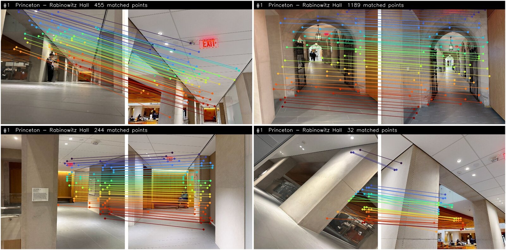

**Vision passes.** Two passes run once per building and feed the agent's questions and the packet.

- **Positions.** Claude Haiku reads four views at each position. It records room type, floor surface, window, signage, stairs or elevator in view, safety equipment, and stretcher hazards. 695 positions are committed, not hand-checked.
- **Site.** The aerial pass runs Vexcel ortho and oblique imagery and Vexcel's own detections (parking, awnings) through Claude Opus to find entrances, staging spots and obstructions. Haiku placed an entrance 12 m off, so the site pass uses Opus.

**GPU.** MegaLoc and LoFTR run on a Lambda **H100**. The box also runs the console and the agent watcher, and the console is tunnelled to a laptop for the demo. A photo match takes about 1–3 s there, after a one-time model load of about 4.5 s. On a laptop CPU it takes 20–130 s, so the GPU is what makes a live demo possible.

**Telling buildings apart.** A photo sent with no address is searched against every local index, and a building is accepted only if it passes six gates ([`perception/identify.py`](https://github.com/richard-shan/phack-pinpoint/blob/main/perception/identify.py)):

- at least 60 inliers and an inlier ratio of 0.5 or more;
- embedding similarity of 0.25 or more;
- matches covering at least 4% of the photo;
- a combined-score lead of 0.08 or more;
- 1.5 times the next building's inliers.

Otherwise the answer is "unknown". Random noise, a blank frame and an unrelated lobby all came back unknown.

---

## 6. User Interface via Text Message

> **Photon, Messaging agent on Photon 2.0.** The caller's line is iMessage through Photon 2.0.

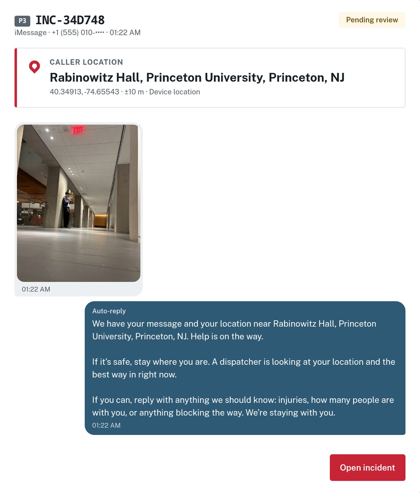

- **Wiring.** The bridge ([`live/photon.py`](https://github.com/richard-shan/phack-pinpoint/blob/main/live/photon.py)) talks to the Photon 2.0 REST API with idempotency keys. It listens for events over a socket with a saved cursor, so a restart picks up where it left off.
- **A photo opens an incident.** An inbound photo becomes a new incident in the console's call queue. Text that follows belongs to the latest photo. If the photo carries a location, the incident opens at once and the caller gets "Help is on the way" without waiting for the match.
- **Two-way messages.** Dispatcher messages and the agent's questions go back to the caller, and replies appear in the console thread.
- **Closure.** On approval the caller gets a short closure text. The crew packet is not sent to the caller.
- **Telegram** runs the same flow through the Bot API.
- **Latency.** The first reply to the caller has to arrive within 3 s, and a self-check script tests it ([`live/selftest.py`](https://github.com/richard-shan/phack-pinpoint/blob/main/live/selftest.py)).

---

## 7. Frontend and integration

**Dispatcher console** ([`app/`](https://github.com/richard-shan/phack-pinpoint/tree/main/app)). The console is a Node server with no dependencies, plus one page laid out like a CAD screen:

- a call queue with incident numbers and priorities;
- an incident view that opens on the building's 3D model with the route, with **3D full screen** for a larger view ([`app/live-3d.html`](https://github.com/richard-shan/phack-pinpoint/blob/main/app/live-3d.html));
- **Interior**: the route registered in the Matterport viewer through its SDK, with **3D overview**, **Go to entry** and **Follow route**;
- **Exterior**: the aerial approach;
- foot and stretcher toggles, an elevator toggle, and blocking a segment (each one saves a new route revision for review);
- the review panel with the packet, the photo-match evidence and the CoStar record.

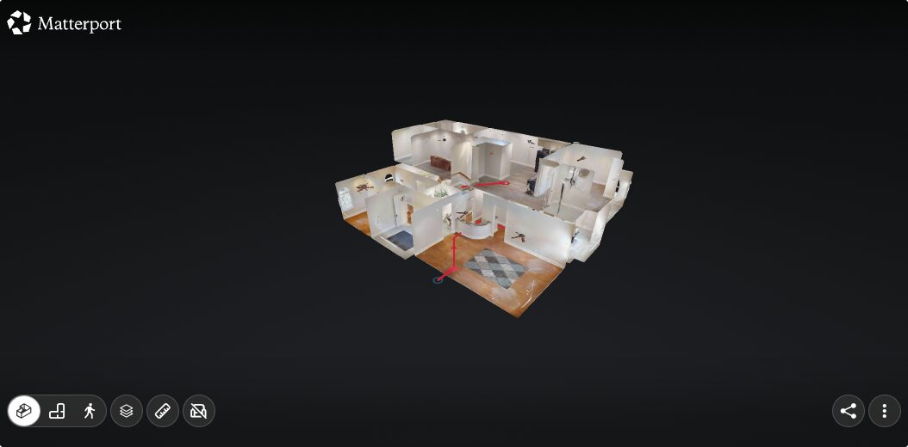

**Integration** ([`live/`](https://github.com/richard-shan/phack-pinpoint/tree/main/live)). The four lanes were built against an agreed set of tool signatures, with stubs at first. `live/tools.install()` swaps lane A's and B's real tools in for the agent's stubs. `live/packet.py` writes the packet from tool results, with a source on every line. The agent watcher picks up each new incident from the console and posts its route, questions and packet back. A script on the laptop, [`pinpoint-gpu.sh`](https://github.com/richard-shan/phack-pinpoint/blob/main/pinpoint-gpu.sh), tunnels to the console on the GPU box, so a laptop runs the demo at GPU speed.

**The agent** ([`agent/`](https://github.com/richard-shan/phack-pinpoint/tree/main/agent)). An agent runs each incident on these tools: it looks up the building, places the caller, reads the site, routes, and checks the packet before the dispatcher sees it. It keeps a belief over the likely positions and asks the caller a question only when the answer could change the door, choosing the question that best splits the candidates and stopping after three. Every factual packet line carries a source tag, and a line whose source does not resolve moves to "Not confirmed".

> **LangChain, Best use of deepagents.** The same steps also run as a deepagents Commander with five subagents (records, locator, site, router, verifier), where sending the packet is an interrupt that waits for the dispatcher. When the photo match is unsure, an evidence court convenes: a deepagents scout argues for each candidate spot and a judge on Claude Opus rules. It stays out of sight when it agrees and reroutes when it overrules. On one Rabinowitz Hall photo it told two identical hallways apart by reading the "1" on a floor directory sign.

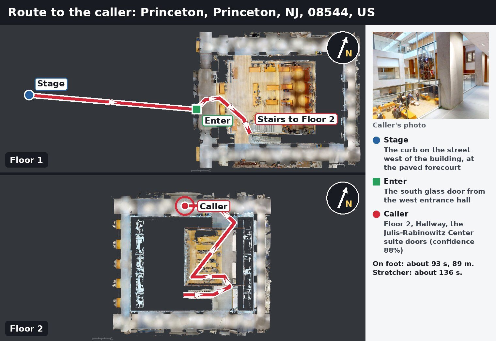

---

## 8. Results

**Held-out test.** [`live.evaluate`](https://github.com/richard-shan/phack-pinpoint/blob/main/live/evaluate.py) renders a photo at a random scanned position, removes that position from the index, and runs the whole chain with a simulated caller. The matcher then knows the place only from neighbouring positions 1–3 m away, as it would for a caller standing between scanned spots.

| Building | Within 3 m | Within 5 m | Right floor | Right door |
|---|---|---|---|---|
| 7900 Fannin St | 10 / 12 | 11 / 12 | 12 / 12 | 10 / 12 |
| 12814 Willow Centre Dr | 8 / 12 | 9 / 12 | 11 / 12 | 10 / 12 |
| Rabinowitz Hall | 4 / 10 | 8 / 10 | 10 / 10 | 10 / 10 |
| **All three** | **22 / 34** | **28 / 34** | **33 / 34** | **30 / 34** |

Most misses came with low confidence, so the agent asked the caller questions. The one to worry about was at Fannin St: a photo from one arm of a symmetric corridor was placed 21 m away in the other arm at 84% confidence, so no question was asked and the crew was sent through the wrong door.

**Real phone photos.** Photos texted over iMessage from inside Rabinowitz Hall, the one building we could get into, were placed where they were taken (section 5). The table uses rendered photos because each has an exact true position to measure from.

**The matcher alone.** On 2,856 synthetic queries over five buildings, the first guess was within 3 m for 57–58% of held-out queries, and the right position was in the top five for 86%. At scanned spots the first guess was right 94–97% of the time.

**What is assumed.** Travel times use assumed speeds, staging spots were placed by eye, and the vision passes have not been checked by hand. The packet labels each of these. Nothing contacts real emergency services.

---

## 9. Unsuccessful attempts

- **Fine-tuning DINOv2 on our scans made matching worse.** We trained on 62 scans, 382 rooms and 30,848 views, and tested on a building the model had never seen. Room top-1 at scanned spots fell from 0.83 to 0.64, and held-out queries fell from 0.49 to 0.40. Larger DINOv2 models and 448 px input did not help either.
- **A per-building head did help, then lost its job.** It was a 512-d layer trained with a supervised-contrastive loss, and it raised held-out room top-1 from 0.49 to 0.59 on DINOv2. We dropped it when we switched to MegaLoc.
- **Trusting the scans' georeference.** It was 20–30 m off at several buildings, so we marked doors and staging spots on the aerial by hand.
- **Fetching fast.** Sixteen parallel image downloads per scan got us blocked by Matterport for 45 minutes. Bulk downloads now run one at a time.
- **Letting the model drive freely.** On the deepagents path one run called `look` about thirty times and invented photo paths before settling. That is why the packet is written from tool results rather than by the model.

---

## 10. Lessons learned, and what's next

**Lessons:**
- **Use held-out positions.** Testing on photos cut from indexed positions flatters the matcher, and held-out positions are the honest test.
- **Calibrate, don't threshold.** The calibrator was right 88–91% of the time when it confirmed a match, against 69–72% for the fixed 60-point rule.
- **Ask only when it matters.** A question earns its place only if the answer could change the door or save time.

**Next:** we want to try real phone photos in more buildings and send the packet straight into a real CAD system, so dispatchers never leave the screen they already use. After that come voice calls and pre-incident plans written ahead of time for every building.

---

## 11. Reproducibility

```sh
uv venv --python 3.12 .venv
uv pip install --python .venv/bin/python -r env/requirements.txt
.venv/bin/python -m live.setup                    # console data, scan graphs, Matterport viewer
.venv/bin/python -m live.serve                    # console at http://localhost:4175/live.html
.venv/bin/python -m live.index 6550930            # photo index for one building (needs perception/requirements.txt)
.venv/bin/python -m live.run --building 6550930 --photo demo/6550930_gbqgw9.jpg --console
.venv/bin/python -m live.run --watch              # or start incidents from the console or iMessage
.venv/bin/python -m live.evaluate 6550930 --n 12 --held-out
```

**Links:**
- [Repository](https://github.com/richard-shan/phack-pinpoint)
- [`live/README.md`](https://github.com/richard-shan/phack-pinpoint/blob/main/live/README.md): the full run, the buildings, and what is and is not real

**Team:**
- Richard Shan: graphs, routing, frontend and integration
- Sophia Hou: perception, ML, frontend and integration
- Connor White: the deepagent
- Sean Donahue: work on the text messaging

**References:**

[1] G. Berton and C. Masone, "MegaLoc: One Retrieval to Place Them All," arXiv:2502.17237 (2025). <br>
[2] S. Izquierdo and J. Civera, "Optimal Transport Aggregation for Visual Place Recognition" (SALAD), CVPR 2024, arXiv:2311.15937. <br>
[3] J. Sun, Z. Shen, Y. Wang, H. Bao, X. Zhou, "LoFTR: Detector-Free Local Feature Matching with Transformers," CVPR 2021, arXiv:2104.00680. <br>
[4] M. Oquab et al., "DINOv2: Learning Robust Visual Features without Supervision," arXiv:2304.07193 (2023). <br>
[5] LangChain, deepagents. Photon 2.0. CoStar, Matterport and Vexcel APIs (HackPrinceton F26 CoStar kit).
